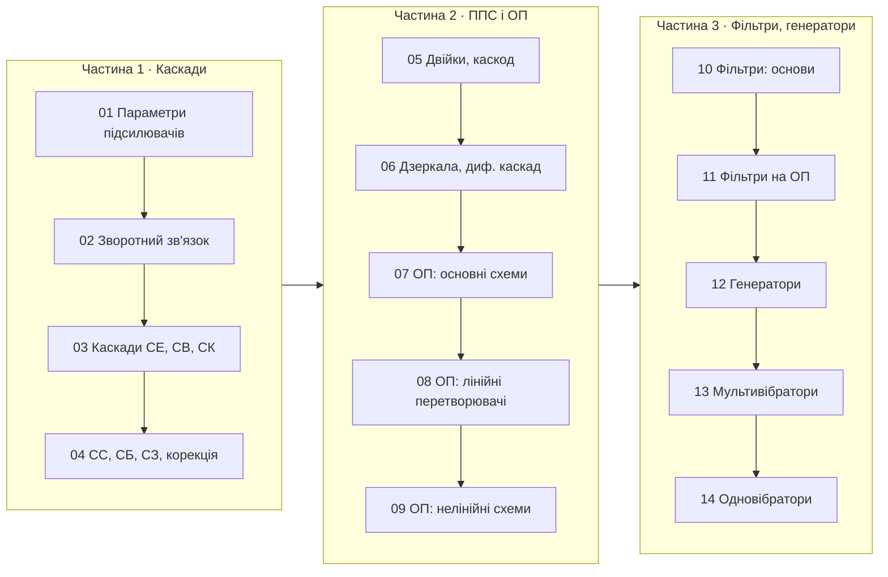

<div align="center">

# 📻 Схемотехніка радіотехнічних пристроїв

**Інтерактивний конспект лекцій українською мовою**

Національний університет «Чернігівська політехніка»

[](https://mybinder.org/v2/gh/vim4all/Lectures_Schematics_of_radio_technical-devices_in_Ukrainian/HEAD)
[](https://colab.research.google.com/github/vim4all/Lectures_Schematics_of_radio_technical-devices_in_Ukrainian)
[](https://github.com/vim4all/Lectures_Schematics_of_radio_technical-devices_in_Ukrainian/releases/latest)
[](https://github.com/vim4all/Lectures_Schematics_of_radio_technical-devices_in_Ukrainian/actions/workflows/notebooks.yml)


</div>

---

**Викладач:** Пахалюк Богдан Петрович, доктор філософії

**Дисципліна:** Схемотехніка радіотехнічних пристроїв (14 тем, 3 частини — відповідно до трьох груп екзаменаційних питань)

**Сторінка в Moodle:** https://eln.stu.cn.ua/course/view.php?id=4578

**Мова викладання:** українська

## ✨ Що всередині

Кожна тема — окремий Jupyter-зошит, який можна відкрити й виконати незалежно від інших. Розділи тем відповідають екзаменаційним питанням (номери вказано в таблиці змісту і на початку кожного розділу).

- 📖 **Теорія** з формулами, виведеннями і розрахунковими співвідношеннями
- 🔌 **Схеми**, побудовані кодом у [SchemDraw](https://schemdraw.readthedocs.io/) з умовними позначеннями за ДСТУ (ОП — прямокутник ▷∞, логічні елементи — «&», «1»)
- ⚙️ **Моделювання** у [PySpice](https://pyspice.fabrice-salvaire.fr/) + [ngspice](https://ngspice.sourceforge.io/) на реальних моделях: ОП μA741, транзистори 2N3904, таймер 555, КМОН-елементи
- 🔬 **Інтерактивні графіки**: змінюйте параметри повзунками й порівнюйте результат моделювання з формулами
- 🎛️ **Особливий акцент на операційних підсилювачах**: підсилювачі, повторювачі, суматори, інтегратори, диференціатори, вимірювальні підсилювачі, перетворювачі струму і напруги, компаратори, тригери Шмітта, прецизійні випрямлячі, лог-підсилювачі, активні фільтри, генератори, мультивібратори й одновібратори на ОП
- ✅ **Питання для самоперевірки** та 📝 **задачі** з відповідями в кожній темі
- 📥 **PDF-версії** тем для читання без Jupyter і друку

## 📥 Завантажити PDF

Готові PDF-версії публікуються як файли [релізу](../../releases/latest). Інтерактивні графіки в PDF показано для значень параметрів за замовчуванням.

- 📘 [Усі теми одним файлом (PDF)](../../releases/latest/download/Lectures_all.pdf)

**Частина 1:** [Тема 1](../../releases/latest/download/Topic_01.pdf) · [Тема 2](../../releases/latest/download/Topic_02.pdf) · [Тема 3](../../releases/latest/download/Topic_03.pdf) · [Тема 4](../../releases/latest/download/Topic_04.pdf)

**Частина 2:** [Тема 5](../../releases/latest/download/Topic_05.pdf) · [Тема 6](../../releases/latest/download/Topic_06.pdf) · [Тема 7](../../releases/latest/download/Topic_07.pdf) · [Тема 8](../../releases/latest/download/Topic_08.pdf) · [Тема 9](../../releases/latest/download/Topic_09.pdf)

**Частина 3:** [Тема 10](../../releases/latest/download/Topic_10.pdf) · [Тема 11](../../releases/latest/download/Topic_11.pdf) · [Тема 12](../../releases/latest/download/Topic_12.pdf) · [Тема 13](../../releases/latest/download/Topic_13.pdf) · [Тема 14](../../releases/latest/download/Topic_14.pdf)

## 🗺️ Карта курсу



## 📚 Зміст

> Натисніть назву теми, щоб переглянути її на GitHub, або ▶️, щоб запустити в Binder чи Google Colab (без встановлення, у браузері).

### Частина 1 · Основні положення та елементарні підсилювальні каскади на транзисторах

| № | Тема | Питання | Ключові питання | Binder | Colab |
|:---:|---|:---:|---|:---:|:---:|
| **01** | [Підсилювачі. Основні параметри та характеристики](Тема_01_Параметри_та_характеристики_підсилювачів.ipynb) | 1.1–1.5 | класифікація, $K_u$, $K_i$, $K_p$, АЧХ і ФЧХ, амплітудна характеристика, $K_г$, класи A/B/AB/C/D, перехідна характеристика | [▶️](https://mybinder.org/v2/gh/vim4all/Lectures_Schematics_of_radio_technical-devices_in_Ukrainian/HEAD?labpath=%D0%A2%D0%B5%D0%BC%D0%B0_01_%D0%9F%D0%B0%D1%80%D0%B0%D0%BC%D0%B5%D1%82%D1%80%D0%B8_%D1%82%D0%B0_%D1%85%D0%B0%D1%80%D0%B0%D0%BA%D1%82%D0%B5%D1%80%D0%B8%D1%81%D1%82%D0%B8%D0%BA%D0%B8_%D0%BF%D1%96%D0%B4%D1%81%D0%B8%D0%BB%D1%8E%D0%B2%D0%B0%D1%87%D1%96%D0%B2.ipynb) | [▶️](https://colab.research.google.com/github/vim4all/Lectures_Schematics_of_radio_technical-devices_in_Ukrainian/blob/main/%D0%A2%D0%B5%D0%BC%D0%B0_01_%D0%9F%D0%B0%D1%80%D0%B0%D0%BC%D0%B5%D1%82%D1%80%D0%B8_%D1%82%D0%B0_%D1%85%D0%B0%D1%80%D0%B0%D0%BA%D1%82%D0%B5%D1%80%D0%B8%D1%81%D1%82%D0%B8%D0%BA%D0%B8_%D0%BF%D1%96%D0%B4%D1%81%D0%B8%D0%BB%D1%8E%D0%B2%D0%B0%D1%87%D1%96%D0%B2.ipynb) |
| **02** | [Багатокаскадні підсилювачі. Зворотний зв'язок і стійкість](Тема_02_Багатокаскадні_підсилювачі_та_зворотний_звязок.ipynb) | 1.6–1.12 | багатокаскадні підсилювачі, основне рівняння ЗЗ, чотири типи ЗЗ, вплив НЗЗ на опори і смугу, стійкість, корекція «вперед»/«назад» | [▶️](https://mybinder.org/v2/gh/vim4all/Lectures_Schematics_of_radio_technical-devices_in_Ukrainian/HEAD?labpath=%D0%A2%D0%B5%D0%BC%D0%B0_02_%D0%91%D0%B0%D0%B3%D0%B0%D1%82%D0%BE%D0%BA%D0%B0%D1%81%D0%BA%D0%B0%D0%B4%D0%BD%D1%96_%D0%BF%D1%96%D0%B4%D1%81%D0%B8%D0%BB%D1%8E%D0%B2%D0%B0%D1%87%D1%96_%D1%82%D0%B0_%D0%B7%D0%B2%D0%BE%D1%80%D0%BE%D1%82%D0%BD%D0%B8%D0%B9_%D0%B7%D0%B2%D1%8F%D0%B7%D0%BE%D0%BA.ipynb) | [▶️](https://colab.research.google.com/github/vim4all/Lectures_Schematics_of_radio_technical-devices_in_Ukrainian/blob/main/%D0%A2%D0%B5%D0%BC%D0%B0_02_%D0%91%D0%B0%D0%B3%D0%B0%D1%82%D0%BE%D0%BA%D0%B0%D1%81%D0%BA%D0%B0%D0%B4%D0%BD%D1%96_%D0%BF%D1%96%D0%B4%D1%81%D0%B8%D0%BB%D1%8E%D0%B2%D0%B0%D1%87%D1%96_%D1%82%D0%B0_%D0%B7%D0%B2%D0%BE%D1%80%D0%BE%D1%82%D0%BD%D0%B8%D0%B9_%D0%B7%D0%B2%D1%8F%D0%B7%D0%BE%D0%BA.ipynb) |
| **03** | [Каскади зі спільним емітером, спільним витоком і спільним колектором](Тема_03_Каскади_СЕ_СВ_СК.ipynb) | 1.13–1.15 | каскади СЕ, СВ, СК: режим спокою, $K_u$, $R_{вх}$, $R_{вих}$, кола зміщення і стабілізація | [▶️](https://mybinder.org/v2/gh/vim4all/Lectures_Schematics_of_radio_technical-devices_in_Ukrainian/HEAD?labpath=%D0%A2%D0%B5%D0%BC%D0%B0_03_%D0%9A%D0%B0%D1%81%D0%BA%D0%B0%D0%B4%D0%B8_%D0%A1%D0%95_%D0%A1%D0%92_%D0%A1%D0%9A.ipynb) | [▶️](https://colab.research.google.com/github/vim4all/Lectures_Schematics_of_radio_technical-devices_in_Ukrainian/blob/main/%D0%A2%D0%B5%D0%BC%D0%B0_03_%D0%9A%D0%B0%D1%81%D0%BA%D0%B0%D0%B4%D0%B8_%D0%A1%D0%95_%D0%A1%D0%92_%D0%A1%D0%9A.ipynb) |
| **04** | [Каскади СС, СБ, СЗ. Корекція АЧХ](Тема_04_Каскади_СС_СБ_СЗ_та_корекція_АЧХ.ipynb) | 1.16–1.19 | витоковий повторювач, каскади СБ і СЗ, ефект Міллера, витокова і стокова корекція АЧХ | [▶️](https://mybinder.org/v2/gh/vim4all/Lectures_Schematics_of_radio_technical-devices_in_Ukrainian/HEAD?labpath=%D0%A2%D0%B5%D0%BC%D0%B0_04_%D0%9A%D0%B0%D1%81%D0%BA%D0%B0%D0%B4%D0%B8_%D0%A1%D0%A1_%D0%A1%D0%91_%D0%A1%D0%97_%D1%82%D0%B0_%D0%BA%D0%BE%D1%80%D0%B5%D0%BA%D1%86%D1%96%D1%8F_%D0%90%D0%A7%D0%A5.ipynb) | [▶️](https://colab.research.google.com/github/vim4all/Lectures_Schematics_of_radio_technical-devices_in_Ukrainian/blob/main/%D0%A2%D0%B5%D0%BC%D0%B0_04_%D0%9A%D0%B0%D1%81%D0%BA%D0%B0%D0%B4%D0%B8_%D0%A1%D0%A1_%D0%A1%D0%91_%D0%A1%D0%97_%D1%82%D0%B0_%D0%BA%D0%BE%D1%80%D0%B5%D0%BA%D1%86%D1%96%D1%8F_%D0%90%D0%A7%D0%A5.ipynb) |

### Частина 2 · Підсилювачі постійного струму. Операційні підсилювачі

| № | Тема | Питання | Ключові питання | Binder | Colab |
|:---:|---|:---:|---|:---:|:---:|
| **05** | [Складові повторювачі, підсилювальні двійки, каскодні схеми](Тема_05_Складові_повторювачі_двійки_каскод.ipynb) | 2.1–2.3 | пари Дарлінгтона і Шиклаї, двійки СК–СЕ і СК–СБ, каскод | [▶️](https://mybinder.org/v2/gh/vim4all/Lectures_Schematics_of_radio_technical-devices_in_Ukrainian/HEAD?labpath=%D0%A2%D0%B5%D0%BC%D0%B0_05_%D0%A1%D0%BA%D0%BB%D0%B0%D0%B4%D0%BE%D0%B2%D1%96_%D0%BF%D0%BE%D0%B2%D1%82%D0%BE%D1%80%D1%8E%D0%B2%D0%B0%D1%87%D1%96_%D0%B4%D0%B2%D1%96%D0%B9%D0%BA%D0%B8_%D0%BA%D0%B0%D1%81%D0%BA%D0%BE%D0%B4.ipynb) | [▶️](https://colab.research.google.com/github/vim4all/Lectures_Schematics_of_radio_technical-devices_in_Ukrainian/blob/main/%D0%A2%D0%B5%D0%BC%D0%B0_05_%D0%A1%D0%BA%D0%BB%D0%B0%D0%B4%D0%BE%D0%B2%D1%96_%D0%BF%D0%BE%D0%B2%D1%82%D0%BE%D1%80%D1%8E%D0%B2%D0%B0%D1%87%D1%96_%D0%B4%D0%B2%D1%96%D0%B9%D0%BA%D0%B8_%D0%BA%D0%B0%D1%81%D0%BA%D0%BE%D0%B4.ipynb) |
| **06** | [Джерела струму, струмові дзеркала, диференціальні каскади](Тема_06_Джерела_струму_та_диференціальні_каскади.ipynb) | 2.4–2.6 | джерела струму, дзеркала (просте, Відлара, Вілсона), активне навантаження, диференціальний каскад, КПСС | [▶️](https://mybinder.org/v2/gh/vim4all/Lectures_Schematics_of_radio_technical-devices_in_Ukrainian/HEAD?labpath=%D0%A2%D0%B5%D0%BC%D0%B0_06_%D0%94%D0%B6%D0%B5%D1%80%D0%B5%D0%BB%D0%B0_%D1%81%D1%82%D1%80%D1%83%D0%BC%D1%83_%D1%82%D0%B0_%D0%B4%D0%B8%D1%84%D0%B5%D1%80%D0%B5%D0%BD%D1%86%D1%96%D0%B0%D0%BB%D1%8C%D0%BD%D1%96_%D0%BA%D0%B0%D1%81%D0%BA%D0%B0%D0%B4%D0%B8.ipynb) | [▶️](https://colab.research.google.com/github/vim4all/Lectures_Schematics_of_radio_technical-devices_in_Ukrainian/blob/main/%D0%A2%D0%B5%D0%BC%D0%B0_06_%D0%94%D0%B6%D0%B5%D1%80%D0%B5%D0%BB%D0%B0_%D1%81%D1%82%D1%80%D1%83%D0%BC%D1%83_%D1%82%D0%B0_%D0%B4%D0%B8%D1%84%D0%B5%D1%80%D0%B5%D0%BD%D1%86%D1%96%D0%B0%D0%BB%D1%8C%D0%BD%D1%96_%D0%BA%D0%B0%D1%81%D0%BA%D0%B0%D0%B4%D0%B8.ipynb) |
| **07** | [Операційні підсилювачі. Основні схеми включення](Тема_07_Операційні_підсилювачі_основні_схеми.ipynb) | 2.7–2.9 | параметри ОП (μA741), правила ідеального ОП, інвертувальний/неінвертувальний/диференціальний підсилювачі, повторювачі, суматори | [▶️](https://mybinder.org/v2/gh/vim4all/Lectures_Schematics_of_radio_technical-devices_in_Ukrainian/HEAD?labpath=%D0%A2%D0%B5%D0%BC%D0%B0_07_%D0%9E%D0%BF%D0%B5%D1%80%D0%B0%D1%86%D1%96%D0%B9%D0%BD%D1%96_%D0%BF%D1%96%D0%B4%D1%81%D0%B8%D0%BB%D1%8E%D0%B2%D0%B0%D1%87%D1%96_%D0%BE%D1%81%D0%BD%D0%BE%D0%B2%D0%BD%D1%96_%D1%81%D1%85%D0%B5%D0%BC%D0%B8.ipynb) | [▶️](https://colab.research.google.com/github/vim4all/Lectures_Schematics_of_radio_technical-devices_in_Ukrainian/blob/main/%D0%A2%D0%B5%D0%BC%D0%B0_07_%D0%9E%D0%BF%D0%B5%D1%80%D0%B0%D1%86%D1%96%D0%B9%D0%BD%D1%96_%D0%BF%D1%96%D0%B4%D1%81%D0%B8%D0%BB%D1%8E%D0%B2%D0%B0%D1%87%D1%96_%D0%BE%D1%81%D0%BD%D0%BE%D0%B2%D0%BD%D1%96_%D1%81%D1%85%D0%B5%D0%BC%D0%B8.ipynb) |
| **08** | [Інтегратори, диференціатори, вимірювальні підсилювачі, перетворювачі U→I та I→U](Тема_08_Лінійні_перетворювачі_на_ОП.ipynb) | 2.10–2.14 | інтегратор, диференціатор, вимірювальний підсилювач (ЕКГ-приклад), джерело Хауленда, підсилювач фотодіода (TIA) | [▶️](https://mybinder.org/v2/gh/vim4all/Lectures_Schematics_of_radio_technical-devices_in_Ukrainian/HEAD?labpath=%D0%A2%D0%B5%D0%BC%D0%B0_08_%D0%9B%D1%96%D0%BD%D1%96%D0%B9%D0%BD%D1%96_%D0%BF%D0%B5%D1%80%D0%B5%D1%82%D0%B2%D0%BE%D1%80%D1%8E%D0%B2%D0%B0%D1%87%D1%96_%D0%BD%D0%B0_%D0%9E%D0%9F.ipynb) | [▶️](https://colab.research.google.com/github/vim4all/Lectures_Schematics_of_radio_technical-devices_in_Ukrainian/blob/main/%D0%A2%D0%B5%D0%BC%D0%B0_08_%D0%9B%D1%96%D0%BD%D1%96%D0%B9%D0%BD%D1%96_%D0%BF%D0%B5%D1%80%D0%B5%D1%82%D0%B2%D0%BE%D1%80%D1%8E%D0%B2%D0%B0%D1%87%D1%96_%D0%BD%D0%B0_%D0%9E%D0%9F.ipynb) |
| **09** | [Нелінійні схеми на ОП: компаратори, тригери Шмітта, прецизійні випрямлячі](Тема_09_Нелінійні_схеми_на_ОП.ipynb) | дод. (до 3.13–3.20) | компаратори, тригери Шмітта, прецизійні випрямлячі, піковий детектор, логарифмічні перетворювачі *(додаткова тема)* | [▶️](https://mybinder.org/v2/gh/vim4all/Lectures_Schematics_of_radio_technical-devices_in_Ukrainian/HEAD?labpath=%D0%A2%D0%B5%D0%BC%D0%B0_09_%D0%9D%D0%B5%D0%BB%D1%96%D0%BD%D1%96%D0%B9%D0%BD%D1%96_%D1%81%D1%85%D0%B5%D0%BC%D0%B8_%D0%BD%D0%B0_%D0%9E%D0%9F.ipynb) | [▶️](https://colab.research.google.com/github/vim4all/Lectures_Schematics_of_radio_technical-devices_in_Ukrainian/blob/main/%D0%A2%D0%B5%D0%BC%D0%B0_09_%D0%9D%D0%B5%D0%BB%D1%96%D0%BD%D1%96%D0%B9%D0%BD%D1%96_%D1%81%D1%85%D0%B5%D0%BC%D0%B8_%D0%BD%D0%B0_%D0%9E%D0%9F.ipynb) |

### Частина 3 · Фільтрація та генерація сигналів

| № | Тема | Питання | Ключові питання | Binder | Colab |
|:---:|---|:---:|---|:---:|:---:|
| **10** | [Активні фільтри: класифікація, поліноми, елементарні ланки](Тема_10_Активні_фільтри_основи.ipynb) | 3.1–3.3 | класифікація фільтрів, порядок, Баттерворт/Чебишов/Бессель/еліптичний, міст Віна, подвійний Т-міст | [▶️](https://mybinder.org/v2/gh/vim4all/Lectures_Schematics_of_radio_technical-devices_in_Ukrainian/HEAD?labpath=%D0%A2%D0%B5%D0%BC%D0%B0_10_%D0%90%D0%BA%D1%82%D0%B8%D0%B2%D0%BD%D1%96_%D1%84%D1%96%D0%BB%D1%8C%D1%82%D1%80%D0%B8_%D0%BE%D1%81%D0%BD%D0%BE%D0%B2%D0%B8.ipynb) | [▶️](https://colab.research.google.com/github/vim4all/Lectures_Schematics_of_radio_technical-devices_in_Ukrainian/blob/main/%D0%A2%D0%B5%D0%BC%D0%B0_10_%D0%90%D0%BA%D1%82%D0%B8%D0%B2%D0%BD%D1%96_%D1%84%D1%96%D0%BB%D1%8C%D1%82%D1%80%D0%B8_%D0%BE%D1%81%D0%BD%D0%BE%D0%B2%D0%B8.ipynb) |
| **11** | [Активні фільтри на ОП: ФНЧ, ФВЧ, смугові, загороджувальні, фазові](Тема_11_Активні_фільтри_на_ОП.ipynb) | 3.4–3.8 | ФНЧ і ФВЧ Саллена–Кі, смуговий MFB, режекторний (активний twin-T), фазовий фільтр | [▶️](https://mybinder.org/v2/gh/vim4all/Lectures_Schematics_of_radio_technical-devices_in_Ukrainian/HEAD?labpath=%D0%A2%D0%B5%D0%BC%D0%B0_11_%D0%90%D0%BA%D1%82%D0%B8%D0%B2%D0%BD%D1%96_%D1%84%D1%96%D0%BB%D1%8C%D1%82%D1%80%D0%B8_%D0%BD%D0%B0_%D0%9E%D0%9F.ipynb) | [▶️](https://colab.research.google.com/github/vim4all/Lectures_Schematics_of_radio_technical-devices_in_Ukrainian/blob/main/%D0%A2%D0%B5%D0%BC%D0%B0_11_%D0%90%D0%BA%D1%82%D0%B8%D0%B2%D0%BD%D1%96_%D1%84%D1%96%D0%BB%D1%8C%D1%82%D1%80%D0%B8_%D0%BD%D0%B0_%D0%9E%D0%9F.ipynb) |
| **12** | [Генератори гармонійних коливань](Тема_12_Генератори_гармонійних_коливань.ipynb) | 3.9–3.12 | баланс фаз і амплітуд, генератор Колпітца, генератор з мостом Віна, кварцова стабілізація | [▶️](https://mybinder.org/v2/gh/vim4all/Lectures_Schematics_of_radio_technical-devices_in_Ukrainian/HEAD?labpath=%D0%A2%D0%B5%D0%BC%D0%B0_12_%D0%93%D0%B5%D0%BD%D0%B5%D1%80%D0%B0%D1%82%D0%BE%D1%80%D0%B8_%D0%B3%D0%B0%D1%80%D0%BC%D0%BE%D0%BD%D1%96%D0%B9%D0%BD%D0%B8%D1%85_%D0%BA%D0%BE%D0%BB%D0%B8%D0%B2%D0%B0%D0%BD%D1%8C.ipynb) | [▶️](https://colab.research.google.com/github/vim4all/Lectures_Schematics_of_radio_technical-devices_in_Ukrainian/blob/main/%D0%A2%D0%B5%D0%BC%D0%B0_12_%D0%93%D0%B5%D0%BD%D0%B5%D1%80%D0%B0%D1%82%D0%BE%D1%80%D0%B8_%D0%B3%D0%B0%D1%80%D0%BC%D0%BE%D0%BD%D1%96%D0%B9%D0%BD%D0%B8%D1%85_%D0%BA%D0%BE%D0%BB%D0%B8%D0%B2%D0%B0%D0%BD%D1%8C.ipynb) |
| **13** | [Мультивібратори](Тема_13_Мультивібратори.ipynb) | 3.13–3.17 | мультивібратор на ОП, функціональний генератор, шпаруватість, мультивібратори на КМОН-елементах, таймер 555 | [▶️](https://mybinder.org/v2/gh/vim4all/Lectures_Schematics_of_radio_technical-devices_in_Ukrainian/HEAD?labpath=%D0%A2%D0%B5%D0%BC%D0%B0_13_%D0%9C%D1%83%D0%BB%D1%8C%D1%82%D0%B8%D0%B2%D1%96%D0%B1%D1%80%D0%B0%D1%82%D0%BE%D1%80%D0%B8.ipynb) | [▶️](https://colab.research.google.com/github/vim4all/Lectures_Schematics_of_radio_technical-devices_in_Ukrainian/blob/main/%D0%A2%D0%B5%D0%BC%D0%B0_13_%D0%9C%D1%83%D0%BB%D1%8C%D1%82%D0%B8%D0%B2%D1%96%D0%B1%D1%80%D0%B0%D1%82%D0%BE%D1%80%D0%B8.ipynb) |
| **14** | [Одновібратори](Тема_14_Одновібратори.ipynb) | 3.18–3.20 | одновібратори на ОП, на елементах АБО-НЕ, на таймері 555 | [▶️](https://mybinder.org/v2/gh/vim4all/Lectures_Schematics_of_radio_technical-devices_in_Ukrainian/HEAD?labpath=%D0%A2%D0%B5%D0%BC%D0%B0_14_%D0%9E%D0%B4%D0%BD%D0%BE%D0%B2%D1%96%D0%B1%D1%80%D0%B0%D1%82%D0%BE%D1%80%D0%B8.ipynb) | [▶️](https://colab.research.google.com/github/vim4all/Lectures_Schematics_of_radio_technical-devices_in_Ukrainian/blob/main/%D0%A2%D0%B5%D0%BC%D0%B0_14_%D0%9E%D0%B4%D0%BD%D0%BE%D0%B2%D1%96%D0%B1%D1%80%D0%B0%D1%82%D0%BE%D1%80%D0%B8.ipynb) |

## 🧭 Як читати конспект

Код демонстрацій **згорнуто**, щоб не відволікати від матеріалу; розгорнути його можна натиснувши «⋯» ліворуч від комірки. Для роботи повзунків виконайте всі комірки: *Run → Run All Cells*.

| Позначка | Значення | | Позначка | Значення |
|:---:|---|---|:---:|---|
| 🎯 | Мета вивчення розділу | | ✅ | Питання для самоперевірки |
| 📋 | Номери екзаменаційних питань | | 📝 | Задачі для самостійного розв'язання |
| 🔬 | Інтерактивне моделювання | | ⚠️ | Типова помилка |
| ⚡ | Практичне застосування | | 💡 | Цікаво знати |
| 📌 | Підсумок теми | | 📚 | Рекомендована література |

## 🚀 Запуск

**Онлайн:** натисніть [](https://mybinder.org/v2/gh/vim4all/Lectures_Schematics_of_radio_technical-devices_in_Ukrainian/HEAD) — середовище з усіма бібліотеками та ngspice збереться автоматично (перший запуск триває кілька хвилин).

**Google Colab:** натисніть ▶️ у колонці Colab. Перша комірка зошита сама встановить ngspice, PySpice і schemdraw та завантажить SPICE-моделі (близько хвилини); потрібен обліковий запис Google.

**Локально** (Linux / WSL):

```bash
git clone https://github.com/vim4all/Lectures_Schematics_of_radio_technical-devices_in_Ukrainian.git
cd Lectures_Schematics_of_radio_technical-devices_in_Ukrainian
sudo apt install ngspice libngspice0-dev   # симулятор для PySpice
pip install -r requirements.txt jupyterlab
jupyter lab
```

<details>
<summary><b>🛠️ Для викладача: перевірка конспектів і PDF</b></summary>

Перед публікацією всі зошити перевіряються: посилання змісту й навігації між темами мають вести на існуючі якорі та файли, а всі комірки — виконуватися без помилок. Те саме автоматично виконується в GitHub Actions після кожного push.

```bash
python tools/check_notebooks.py            # посилання + виконання всіх комірок
python tools/check_notebooks.py --no-exec  # лише посилання (швидко)
python tools/check_notebooks.py --inplace  # також зберегти результати виконання в зошитах
```

PDF-версії для релізу генеруються з уже виконаних зошитів; потрібні `xelatex` і `pandoc`:

```bash
sudo apt install texlive-xetex texlive-latex-extra texlive-fonts-recommended texlive-plain-generic texlive-lang-cyrillic pandoc fonts-dejavu
pip install nbconvert pypdf
python tools/regenerate_pdfs.py            # усі PDF -> pdf/
python tools/regenerate_pdfs.py Тема_07    # лише вибрані
```

Щоб опублікувати новий реліз, достатньо створити тег версії — GitHub Actions збере всі PDF і прикріпить їх до релізу:

```bash
git tag v1.0.0 && git push origin v1.0.0
```

Структура репозиторію:

```
Тема_NN_*.ipynb            теми 1–14
spice/                     SPICE-моделі: ОП μA741, таймер 555, транзистори, діоди
requirements.txt, apt.txt  залежності Python і системні пакети (також для Binder)
tools/check_notebooks.py   перевірка посилань і виконання зошитів
tools/regenerate_pdfs.py   експорт зошитів у PDF
.github/workflows/         перевірка зошитів і збирання PDF для релізу в GitHub Actions
```

</details>

---

<div align="center">

*Конспект підготовлено: Пахалюк Богдан Петрович, НУ «Чернігівська політехніка»*

</div>
